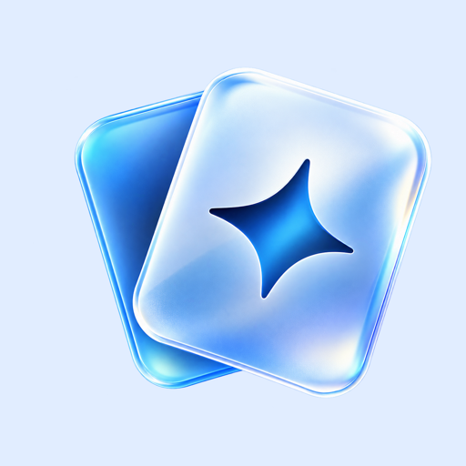
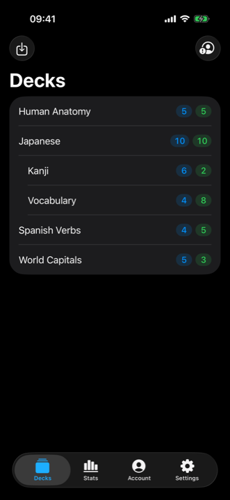
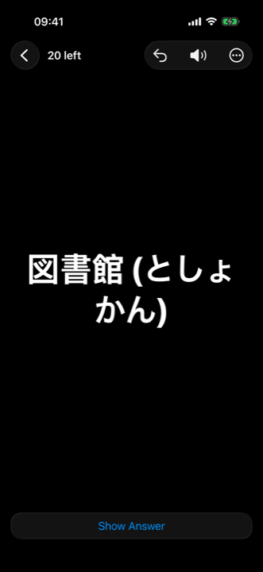
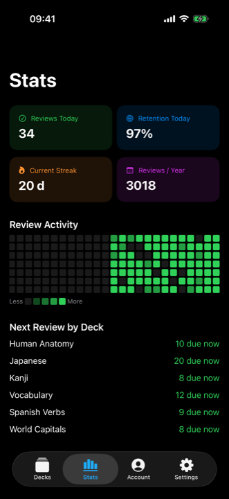

<p align="center">
  
</p>

# Ankios

**A native Anki client for iPhone and iPad, built with SwiftUI and Anki’s Rust backend.**

[Website](https://edouaz.github.io/ankios/) · [Download v0.2.5](https://github.com/edouaz/ankios/releases/tag/v0.2.5) · [Report an issue](https://github.com/edouaz/ankios/issues)

Ankios uses the upstream `anki` crate for scheduling, collection storage and AnkiWeb sync. Cards render as HTML/CSS/JavaScript in a WKWebView, with bundled MathJax for offline formulas.

| Current release | Requirements | Distribution |
| --- | --- | --- |
| **0.2.5 · build 7** | **iOS 16.0+ · iPadOS 16.0+** | Unsigned IPA for sideloading |

The supplied IPA declares both iPhone and iPad support and a minimum OS of 16.0; its executable also targets iOS 16.0. Liquid Glass is used on iOS/iPadOS 26+, with fallback controls on earlier versions. These are verified build requirements; physical-device testing across supported OS versions has not been completed.

Personal project, not affiliated with Ankitects. Not available on the App Store.

## Features

- **Decks** — nested deck list, due counts, create, delete and restart decks.
- **Review** — question/answer rendering, four grading buttons, undo, bury and suspend, plus audio replay.
- **Anki scheduling** — upstream scheduling, including FSRS when enabled in the collection.
- **Sync** — AnkiWeb login, collection and media sync, and custom sync server settings.
- **Offline study** — collection and downloaded media stay on-device; while the app is running, sync resumes on reconnection when signed in.
- **Import** — open `.apkg` packages through the Files picker.
- **Media and math** — local images, `[sound:...]` audio and bundled MathJax on both card faces. [Math support and desktop LaTeX images](docs/math.md).
- **Statistics** — review heatmap, streak, retention and per-deck next due.
- **Preferences** — daily card limits, optional haptics and a daily local reminder.
- **iPad** — portrait/landscape support and constrained reading and grading widths.

<p align="center">
  
  
  
</p>

Screenshots illustrate the existing interface; system appearance varies by OS version.

## Install

1. Download **`Ankios-0.2.5-unsigned.ipa`** from [release v0.2.5](https://github.com/edouaz/ankios/releases/tag/v0.2.5).
2. Sign and install it using a sideloading tool such as [AltStore Classic](https://altstore.io/) or [Sideloadly](https://sideloadly.io/), following that tool’s instructions for your device.
3. Trust the developer profile in **Settings → General → VPN & Device Management** if prompted, and enable Developer Mode if required.

The IPA is unsigned and must be signed for your device. Free Apple ID provisioning normally expires after seven days and needs refreshing. When updating, use the same signing identity and bundle identifier to retain the existing app’s data.

The release includes a SHA-256 checksum:

```sh
shasum -a 256 -c Ankios-0.2.5-unsigned.ipa.sha256
```

### Current limitations

Ankios exposes a subset of Anki’s backend; it is not a complete replacement for desktop Anki. Use desktop Anki for note/template editing and generating LaTeX images. Automatic reconnection sync runs while the app is active, not as a guaranteed background service. Full-sync conflicts currently default to downloading the server collection, with no direction picker; keep a desktop backup before syncing important changes.

## Building

Use a Mac with **Xcode 26 or later** (Icon Composer support), Rust via [rustup](https://rustup.rs/), and `protoc` plus the Swift protobuf generator (`brew install protobuf swift-protobuf`). The supplied IPA was built with Xcode 27.1.

The bridge expects an upstream Anki checkout. The project was developed against **Anki 26.05**, commit `e64c6b1aee3e8d668fb8bbe084beada8e070d985`.

```sh
git clone --branch 26.05 --recurse-submodules https://github.com/ankitects/anki.git
cd anki
git clone https://github.com/edouaz/ankios.git ios

# Add "ios/rsbridge-ios" to [workspace].members in Anki’s root Cargo.toml.
rustup target add aarch64-apple-ios aarch64-apple-ios-sim
ios/build-xcframework.sh
ios/gen-proto.sh
open ios/AnkiApp/AnkiApp.xcodeproj
```

Choose your signing team in Xcode before running on a device. The framework script defaults to deployment target 16.0 and packages device and Apple Silicon simulator libraries; keep the app and native library deployment targets aligned.

### Architecture

```text
SwiftUI interface → Backend.swift actor → SwiftProtobuf messages
                 → rsbridge-ios C FFI → upstream Anki Rust backend
```

The bridge exchanges protobuf bytes, following the same protocol as Anki’s Python layer. Generated Swift messages and `Anki.xcframework` are build outputs and are not committed.

| Path | Purpose |
| --- | --- |
| `AnkiApp/` | SwiftUI app and Xcode project |
| `rsbridge-ios/` | Rust static library and C interface |
| `build-xcframework.sh` | Device/simulator backend build |
| `gen-proto.sh` | Swift protobuf generation |
| `docs/` | GitHub Pages website, screenshots and math documentation |
| `tests/` | Offline WKWebView rendering checks |
| `ROADMAP.md` | Historical implementation plan |

Run the existing rendering checks on macOS:

```sh
python3 tests/test_mathjax.py
```

This checks the production card document and resource handler in a macOS WKWebView; it does not replace iOS device or sync testing.

## License and credits

This repository’s original code is provided under the [MIT License](LICENSE). The app links Anki’s AGPL backend; the compiled application is governed by the AGPL. Bundled MathJax is Apache-2.0 licensed. See [third-party notices](THIRD_PARTY_NOTICES.md) and individual source headers for details.

Built on [Anki](https://apps.ankiweb.net/) by Ankitects and contributors. [Support development](https://ko-fi.com/edouaz).
